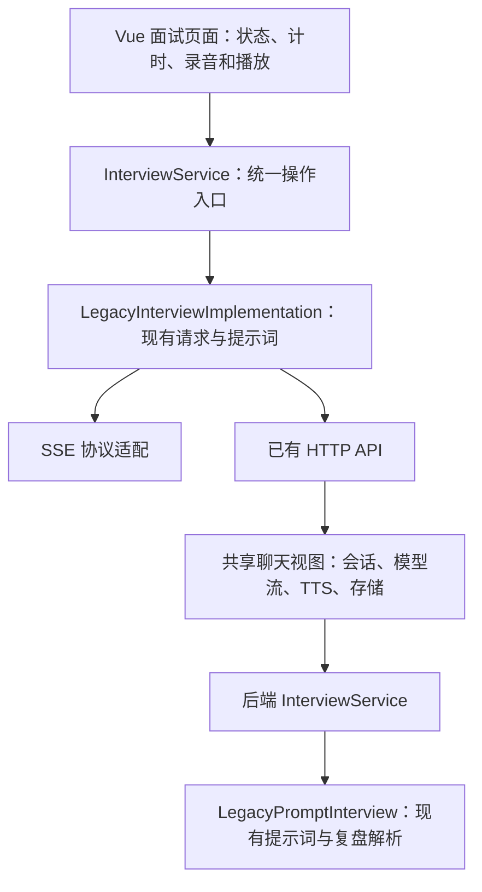

# 模拟面试：保留现有实现，建立替换边界

本次将现有提示词驱动的模拟面试提取为 `legacy` 实现，保留现有页面、接口、数据表和模型连接配置。范围是结构重构；没有接入新模型、适配 Fun-ASR、调整并发/缓存/检索、部署服务器或消耗试用额度。

## 已有实现的真实路径

网页面试通过 `/api/ai/llm/chat/` 流式接口发起请求。页面从 `localStorage.resume` 拼接简历，构造开始、回答与复盘提示词。后端拼接历史、选择风格系统提示词，直接调用 `ChatOpenAI.stream`，并通过 SSE 返回文本、音频和 session ID。复盘通过 `/api/ai/interview/save_review/` 保存到 `InterviewReviewRecord`。

仓库另有 `create_interview_agent()` 和 LangGraph 面试节点，但它们不是这条网页主路径。本次没有把它们改成主实现，也没有将现有实现描述为完整的面试状态机。

## 边界与设计模式



- **Facade（外观）**：前端页面只调用 `start`、`answer`、`generateReview`、`saveReview`、`transcribe`，不再拼提示词、解析网络流或决定后端请求参数。页面继续拥有 Vue 状态、倒计时和浏览器媒体资源。
- **Adapter（适配器）**：前端 legacy 实现将统一操作转换为旧接口和 SSE 协议。HTTP 方法以依赖注入方式传入，适配器不导入 Vue、DOM、具体 Axios 客户端或播放器。读取简历也以回调注入，测试可使用虚构数据。
- **Strategy（策略）**：后端以 `InterviewImplementation` Protocol 描述提示词准备和复盘解析，由 `LegacyPromptInterview` 实现。HTTP 层依赖服务入口，不再内联面试风格和复盘文本解析规则。
- **单一组装点**：前端 `frontend/src/features/interview/index.js`、后端 `backend/ai_integration/interview/__init__.py` 选择现有实现。没有新增空的实现类、全局注册中心、运行时切换开关或未使用的 Repository 层。

## 前端操作契约

| 操作 | 输入 | 输出／副作用 |
| --- | --- | --- |
| `start(context, onEvent)` | `style`、`sessionId` | 流式面试事件 |
| `answer(context, onEvent)` | `answer`、`style`、`sessionId` | 流式面试事件 |
| `generateReview(context, onEvent)` | `messages`、`style`、`sessionId` | `{content, skipped}`，并发送流式事件 |
| `saveReview(context)` | 对话、报告、风格、会话、剩余时间 | 旧版保存结果 |
| `transcribe(formData)` | 音频表单 | 旧版识别结果 |

事件保留 `type` 以及相应的 `content`、`session_id`、`audio`、`message`。文本生成失败时继续交给页面显示错误，不以模拟内容冒充真实生成。复盘内容不足时返回 `skipped=true`，不调用模型。

SSE 读取集中到一个模块：支持 UTF-8 跨字节分块、CRLF、结束时剩余帧；`[DONE]` 后仍读取 session 事件，避免旧接口先发 DONE、再发 session 时丢失会话。去除了旧复盘循环重复解析未完成帧的路径，这是提取协议边界时的正确性修正。

## 后端契约与兼容范围

`prepare_turn(message, history, style, review=False)` 返回不可变的 `InterviewPrompt(system, user)`；`parse_review(content)` 返回原有的 strengths、weaknesses、suggestions、overall_score 字段。

保留四种风格、历史顺序、3000 字符截断、复盘标记提取及评分规则。旧实现的复盘仍使用 chat 系统提示词、在用户提示词前拼 review 提示词；本次不顺手改变这项行为。普通聊天与职业咨询不走面试策略。

共享聊天视图仍拥有 HTTP/SSE、ORM、模型流和 TTS 生命周期。本次抽出的后端策略只负责面试提示词与复盘解析，不能据此声称后端整条链路已经独立为完整面试引擎。后续重写会话编排或模型执行时，可以在保留前端操作契约的前提下增加专用接口和对应适配器。

前端仍采用 localStorage 简历、15 分钟计时、旧 session 回退规则与现有语音代码；这些已知限制没有在本次改成新产品行为。页面模板和 CSS 保持原样。未新增数据库字段或迁移。

## 后续如何替换

1. 实现前端相同的五个操作与事件契约，可选择调用未来的专用面试接口。
2. 在前端组装点替换 `LegacyInterviewImplementation`，页面继续使用 `interviewService`。
3. 如果只调整后端提示词或复盘解析，实现后端 Protocol 并替换后端组装点即可；若重写会话编排，应另建应用服务，不把流程规则塞入旧共享聊天视图。
4. 将新实现套入相同的接口契约测试，再新增其业务行为测试。legacy 基准用来证明旧实现没有被无意改变，不要求新业务行为永远与旧提示词相同。

## 2026-10-26 ASR 协议补通

`/api/asr/speech-to-text/` 保留上传 `audio` 和成功返回 `result/text` 的契约，音频仍为 16 kHz PCM。
根据阿里云 [Fun-ASR 客户端事件](https://help.aliyun.com/en/model-studio/fun-asr-client-events)及[服务端事件](https://help.aliyun.com/en/model-studio/fun-asr-server-events)，识别结果从 `payload.output.sentence` 读取，只拼接最终句并忽略心跳；同时保留原 Gummy `transcription` 字段兼容。
Fun-ASR 请求不再发送旧协议的 `transcription_enabled`。启动失败、识别失败或连接提前结束均不能伪装为空文本成功；请求设 120 秒上限，失败时取消仍在发送的音频任务。

缺少音频返回 HTTP 400，服务失败返回 502，超时返回 504；响应不包含服务商原始错误或凭据。`backend/tests/test_asr.py` 使用假 WebSocket 离线验证上述协议、失败取消和响应脱敏，并纳入 CI。12 项本地测试通过；真实服务与浏览器麦克风验收分别记录，不能由离线测试推断。

2026-10-26 线上少量真实调用结果：面试 SSE 返回文字、14 个音频块和 session ID，复盘测试记录保存读取成功；CosyVoice 合成的短句通过实际 ASR 上传接口准确识别。对应发布、运行镜像及证据见 [部署状态](deployment-status.md)。公网浏览器录音仍待域名/HTTPS 与用户媒体权限验收，不据此宣称完整浏览器语音面试通过。

## 验证

2026-10-23 本地结果：前端 32 项、后端面试 6 项、原有鉴权 16 项测试通过，生产模式前端构建通过，模板/CSS 与重构前一致。代码已随 `33cbc57` 通过 build-only CI 的镜像和联调验证，并整合进 master；master 发布与真实模型/浏览器验收仍需分别核对，见 [运维接手记录](deployment-status.md)。

- `frontend/tests/fixtures/interview-legacy.json` 从重构前提交 `9837e71` 的实际页面函数捕获，使用虚构简历与对话。覆盖四种风格的开始、回答和复盘请求，共 12 组请求。
- 前端测试检查请求与旧基准一致、SSE 分块、音频事件、错误事件、session ID、复盘保存字段以及替换实现可通过同一服务运行。
- 后端测试以虚构提示词和模型响应执行实际聊天视图函数，检查惰性流式调用、SSE、历史记录保存及普通聊天/职业咨询不经过面试策略；不连接真实数据库或模型。
- 原有登录、路由、API 合同与配置测试仍应通过；构建只能验证工程可编译，不代表浏览器或真实模型验收。

```bash
node --test frontend/tests/auth.test.mjs frontend/tests/config.test.mjs frontend/tests/api-contract.test.mjs frontend/tests/interview.test.mjs
python -m unittest discover -s backend/tests -p 'test_interview.py' -v
cd backend
../.venv/Scripts/python.exe -m django test tests.test_auth --settings=tests.auth_settings
```

## 发布与业务验收

本次重构不增加服务、依赖或数据库字段，不需要专项数据迁移；镜像入口原有的 `manage.py migrate` 仍会执行，发布其他改动时应一并核对。无需为切换 legacy 新增环境变量，现有模型配置继续生效。前端和后端需构建发布包含对应代码的镜像，不能只改服务器 `.env`。

配置同步和容器健康通过后，再独立验收：登录进入面试、四种风格开始提问、文字回答与继续提问、session 连续、结束复盘、复盘保存及历史详情。真实模型验收会消耗账户额度，应在明确授权后执行并记录模型、时间和结果；离线基准不能代替回答质量验证。

ASR/TTS 和浏览器麦克风/播放权限另行验收。2026-10-26 已补 Fun-ASR 协议适配，真实调用结果见 [部署状态](deployment-status.md)；不能将最初的结构拆分或 TTS 开关传递写成浏览器语音面试已跑通。当前独立企业服务和本地向量模型的缺口也没有由最初的重构补齐。
